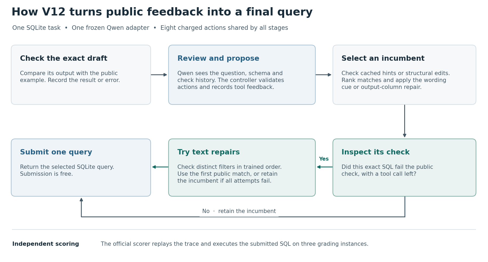
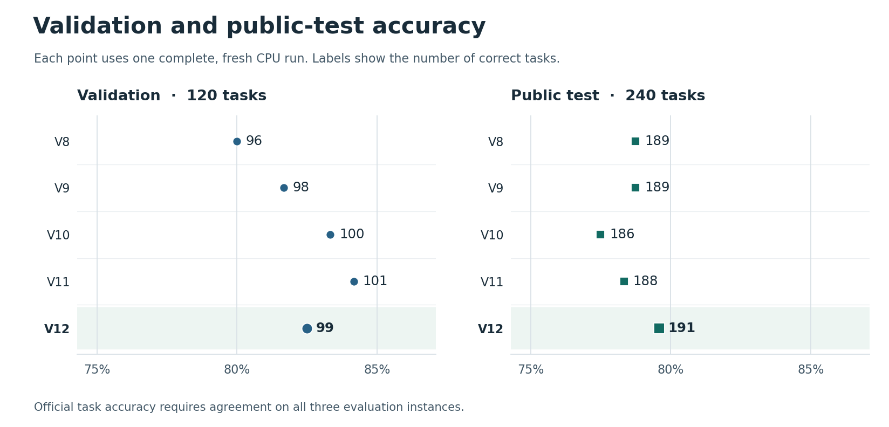

# When a public match is misleading
## A CPU SQL-repair agent for DASE7506 Project 3

**Author** Li Shanghang · **Student ID** 3036705979 · **Evaluated configuration** V12 with the V7 LoRA adapter

V12 solved **191 of 240 test tasks (79.58%)** and **99 of 120 validation tasks (82.50%)** with the supplied scorer. A task counts as correct only if the submitted query produces the expected result on all three database instances. The agent can inspect one public instance during prediction. Of the 216 final queries that matched the public test instance, 25 failed the full evaluation. This gap motivated a repair policy that considers the question, the SQL structure and execution feedback together. These are local, self-reported results.



*Figure 1. Qwen proposes actions. Python controls tool access, records actual outcomes and makes the final choice from checked SQL candidates.*

## Agent design

The first action checks the supplied draft on the public instance. A matching draft can be accepted early when the risk screen finds no reason to look further. Otherwise the controller gathers schema information and supplies the question, draft, expected public result and remaining budget to Qwen. Risk signals include empty results, join cardinality, aggregation, negation and ordering with a limit. Per-task memory retains recent probes, distinct checked SQL, up to four hint strings and any retrieved training example. The model can request an allowed tool, check a candidate or propose a submission. Invalid requests receive bounded corrective feedback. The final runs used schema, hints and checks. They made no charged retrieval or standalone execution calls.

At the point of submission, the controller can use the remaining budget to obtain supplied hints and check distinct suggestions. If no candidate matches publicly, it can try structural edits learned from training examples. Two lightweight logistic scores prioritize structural edits and compare publicly matching candidates. Replacing an incumbent generally requires a score advantage above 0.12. A subsequent pass checks whether training-derived question phrases imply a missing SQL operator and whether a surplus output column can be safely removed. The wording rule only replaces a candidate when exactly one checked match satisfies its requirements. On ordered tasks, the projection rule also requires an outer `LIMIT 1`.

V12 adds one final opportunity to repair text predicates. It acts only when the exact query about to be submitted has already failed a real public check and tool budget remains. It tests distinct candidates in a train-derived order, covering substring matching, case folding, splitting a two-part name across schema columns and extending a text value with a preceding capitalized word from the question. It submits a publicly matching repair if found. Otherwise it keeps the incumbent. This gate spent 18 additional public checks across the test split and corrected two final answers.

## Model, training and provenance

Inference uses the official `Qwen/Qwen3-0.6B` snapshot `c1899de289a04d12100db370d81485cdf75e47ca` with one unmerged V7 PEFT adapter. The base has 596,049,920 parameters and the adapter has 10,092,544, giving 606,142,464 loaded parameters. The model runs locally in CPU float32, with greedy decoding, thinking disabled, an 8,192-token prompt cap, four generations per task and 384 new tokens per generation. The runner reuses one loaded model. The LoRA configuration used rank 16, alpha 32 and dropout 0.05 on the query, key, value, output, gate, up and down projections.

| Adapter stage | Training examples and source | Optimization |
| --- | --- | --- |
| SFT, epoch 3 | 564 examples from the 480 official training tasks, including reference SQL and real execution feedback | 3 epochs, 108 steps, learning rate 0.0002 |
| On-policy, epoch 2 | 2,002 imitation actions from training trajectories plus 564 SQL-retention examples | 2 epochs, 322 steps, learning rate 0.00005 |
| V7 paired, epoch 1 | 132 successful training replays plus 192 synthetic actions from 96 paired SQL motifs | 1 epoch, 41 steps, learning rate 0.000015 |

SFT trained a new adapter on the frozen base. Each subsequent stage continued the previous adapter. The paired examples used training-derived schema and column names with artificial rows to expose differences such as join multiplication, counted entities and boundary comparisons. Final training used AdamW and cross-entropy on assistant and end-of-sequence tokens, with prompt and padding positions masked. The seed was 42. The deployed model used the supplied Spider-derived course material and its train-derived transformations. The course distribution contains its CC BY-SA 4.0 notice. Supplied model hints are cached course data. No additional external SQL corpus entered the deployed training pipeline.

The structural rankers used 973 checked candidates from 382 training tasks across 94 schemas. Another 98 training tasks across 24 schemas, with 230 checked candidates, were held out for these incremental components. Upstream adapter stages had used the full training split. Twenty wording patterns met the support thresholds of at least eight tasks and five schemas, an operator frequency of at least 95%, and a lift of at least 0.30 over its training marginal. Four fitting examples supported substring matching and two supported case folding. The incremental holdout showed no additional separation for that fallback, so its validation gain rests on one task. Training labels came from the training split. Validation informed policy selection. The distributed test set was used for reporting successive frozen versions, which limits claims about generalization to a new benchmark.

## Results and controlled comparisons



*Figure 2. Each version was evaluated on the same 120 validation and 240 test tasks. The controlled comparisons below isolate individual changes.*

| Frozen configuration | Validation | Test |
| --- | ---: | ---: |
| V8, learned ranking and structural repair | 96/120 · 80.00% | 189/240 · 78.75% |
| V9, wording and projection checks | 98/120 · 81.67% | 189/240 · 78.75% |
| V10, V4-prefix branch with V8 | 100/120 · 83.33% | 186/240 · 77.50% |
| V11, V10 with text fallback | 101/120 · 84.17% | 188/240 · 78.33% |
| **V12, V9 with text fallback** | **99/120 · 82.50%** | **191/240 · 79.58%** |

| Controlled change | Correct on validation, before → after | Correct on test, before → after |
| --- | ---: | ---: |
| Choose raw matching candidates with the trained comparator in place of taking the first new public match. Keep the same V8 candidate checks. | 95 → 94 (2 gains, 3 losses) | 181 → 187 (7 gains, 1 loss) |
| Enable structural repair with the V8 comparator held fixed. | 94 → 96 (2 gains, 0 losses) | 187 → 189 (2 gains, 0 losses) |
| Enable the final text fallback with V9's model and earlier decisions held fixed. | 98 → 99 (1 gain, 0 losses) | 189 → 191 (2 gains, 0 losses) |

The first comparison used identical charged tool histories for all 360 tasks. V9 and V12 had identical model transcripts on all 240 test tasks. V12 used nine extra checks on validation and 18 on test. Eleven of the 26 test tasks with an exactly checked, failing incumbent took a fallback attempt. The fresh V12 predictions reproduced the replay's final SQL on all 120 validation and 240 test tasks. V11 had the highest validation accuracy, while V12 had the highest observed test accuracy.

| V12 behavior | Validation | Test |
| --- | ---: | ---: |
| Initially correct drafts preserved | 46/47 | 87/88 |
| Initially incorrect drafts repaired when the public check failed | 42/57 | 93/134 |
| Initially incorrect drafts repaired when the public check passed | 11/16 | 11/18 |
| Final public matches that failed the full scorer | 14/113 | 25/216 |

## Failure analysis and safeguards

On validation, a request for Linda Smith's age produced a comparison between the surname column and the entire name. An empty public result concealed the mistake. The two other instances exposed it. The text fallback never ran because the incumbent had passed its public check. In another task, the agent counted students by gender but omitted the condition comparing age with the overall average. It exhausted all eight tools and failed on all three instances. Across the 21 validation failures, five had a correct checked candidate that the selector missed. The other 16 never produced a correct checked candidate. Perfect selection from the existing checked candidates would therefore have reached 104/120 on this split.

Untrusted questions, tool output, retrieved examples, hints and generated SQL can contain strings that resemble instructions. The controller places task data in bounded, labelled prompt sections and converts model output to a restricted action vocabulary. It rejects invalid or repeated actions, accepts single read-only query forms and uses the supplied SQLite restrictions and execution limits. Model text cannot award a successful check or increase the budget. Only the official public tool records that outcome. A misleading public match remains possible even when these controls work, as the surname example illustrates.

## Runtime and reproduction

| Fresh CPU measurement | Validation | Test |
| --- | ---: | ---: |
| Prediction wall time | 24.4 min | 90.6 min |
| Official scoring wall time | 3.1 s | 6.5 s |
| Total CPU time across threads, prediction and scoring | 96.9 min | 361.1 min |
| Sampled peak process-tree memory | 3.65 GiB | 3.97 GiB |
| GNU time maximum RSS | 4.87 GiB | 4.88 GiB |
| Charged calls, mean / maximum per task | 561 total, 4.675 / 8 | 1,119 total, 4.663 / 8 |
| Check / schema / hint calls | 331 / 110 / 120 | 650 / 229 / 240 |
| Model generations / generated tokens | 275 / 8,708 | 596 / 18,323 |

Both measurements used one CPU prediction worker with four Torch compute threads and one inter-op thread, Python 3.12.3, PyTorch 2.7.1+cu128 on CPU, Transformers 4.53.2, PEFT 0.17.1 and SQLGlot 27.29.0. The memory rows use separate collectors. Both runs stayed under 16 GiB and within the assignment limits.

Extract the source and adapter ZIPs separately. Prepare the official starter, the pinned base snapshot above and the source export's dependencies. Run these commands in that Python environment, replacing the absolute paths with the extracted directories. Each output directory should be new.

```bash
export MP3_BASE_MODEL=/abs/local/Qwen3-0.6B
export MP3_ADAPTER_DIR=/abs/extracted-adapter
python /abs/source/reproduce.py --starter /abs/clean-starter --split validation --output-dir /abs/new-validation
python /abs/source/reproduce.py --starter /abs/clean-starter --split test --output-dir /abs/new-test
```

The CPU runner performs the following model load. It records prompts, generated text, token counts and model identity for each completion.

```python
import os
import torch
from peft import PeftModel
from transformers import AutoModelForCausalLM, AutoTokenizer

base = os.environ["MP3_BASE_MODEL"]
adapter = os.environ["MP3_ADAPTER_DIR"]
tokenizer = AutoTokenizer.from_pretrained(
    base, local_files_only=True, trust_remote_code=False
)
model = AutoModelForCausalLM.from_pretrained(
    base, local_files_only=True, trust_remote_code=False, use_safetensors=True,
    torch_dtype=torch.float32, attn_implementation="sdpa"
).to("cpu")
model = PeftModel.from_pretrained(
    model, adapter, is_trainable=False, local_files_only=True
)
model.eval()
```

The export records the public base model name in the adapter config. The loader uses `MP3_BASE_MODEL` explicitly. The V7 adapter weight SHA-256 is `2af3b904143eaffbf4a76267357c30f474a9c7408b38c76bc5f9ee8d63394aab`. Add `--score-only` with a separate output directory to rescore the included predictions. The source ZIP includes `submission.py`, `configs/selected.json`, both prediction files and complete score JSONs in `outputs/`, plus configs, metadata, loss logs and provenance for the three adapter stages in `training_records/`.

**External assistance.** OpenAI Codex assisted with implementation, debugging, experiments, analysis, figures and report preparation. A project example supplied during development informed the candidate pool and staged ranking design. The evaluation used the local Qwen model, the adapter described above and the supplied task tools.
