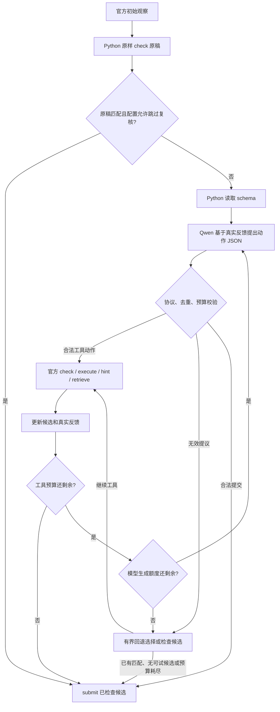

# SQL Repair Agent 第二轮实验报告

> 本文保留第二轮归档时的结果和默认配置说明。第三轮已完成，当前默认及输出见 [第三轮报告](../v3/v3_report.md)；第二轮原始结果仍在 runs/e15_review_selected。

本报告比较固定 Python 控制器的第一轮方案与新增的模型动作决策、语义复核及训练反馈监督。准确率均来自原样官方评分器，要求每题三个实例全部通过。

## 结论

新方案测试集：**181/240，75.42%**；第一轮为 **175/240，72.92%**。净变化 **+6 题，+2.50 个百分点**。

新方案验证集选用 `e13_review_risk`；最终默认方案为 `e13_review_risk`。选择依据为预先完成的验证集比较，记录在 [v2_selection.json](v2_selection.json)。选择记录生成后才运行新方案完整测试集，未根据测试结果修改规则。

## 作业规则核对

README 允许修改控制器、提示、工具决策、上下文、候选排序和指定 Qwen3-0.6B 上的 LoRA。新实现保持 create_agent/act 接口，每次只返回一个原有官方动作。模型内部 JSON 的 reason_code 和 candidate ID 不进入官方动作字段，由 Python 转换并校验。

- 先原样 check 原稿；需要继续时读取 schema，repair_hint 的前置条件满足。数据库只通过官方工具访问，Agent 不读评分参考或额外数据库，不修改 observation、trace 或官方程序。
- 每题最多 8 次收费工具，submit 免费；模型最多 4 次生成，每次最多 384 新 token。规划、复核和无效提议都计入生成次数，提示/文本/token/模型身份全部保留。
- 推理模型只加载一次、workers=1、CPU 四核、离线 safetensors、trust_remote_code=False；运行器监测 16 GiB RSS 和两小时预测/180 秒评分上限。GPU 仅用于训练及 train 轨迹采集。
- 唯一基座为 Qwen/Qwen3-0.6B@c1899de289a04d12100db370d81485cdf75e47ca；只更新单个未合并 LoRA 的 A/B，未训练 embedding、lm_head、bias 或 modules_to_save。
- 所有新增训练材料来自 train；validation 用于策略选择，test 仅自测比较。训练集三实例标签通过官方评分器获得，不传给推理 Agent。
- 共用 .venv，保留第一轮实现、adapter 和原始评分；当前未创建 peer_reviews 或 dist，也未上传。

官方数据和基座哈希、adapter 张量与大小核验见 [v2_artifact_verification.json](v2_artifact_verification.json)，受控变量与源码快照核对见 [v2_controlled_comparison_audit.json](v2_controlled_comparison_audit.json)。运行预算和输出副本核对见 [v2_runtime_audit.json](v2_runtime_audit.json)。官方 scorer 已对下表所有完成运行重放工具轨迹；成绩是本机自测，教师复现状态不由本地程序决定。

## 实际实现与分工

初始化由 Python 保证原稿 check；需要继续时读取 schema，低风险匹配原稿按已选策略可直接提交。其余任务由 Qwen 提出 check、execute、repair_hint、retrieve 或 submit；submit 只能选择已经 check 的候选。Python 检查查询格式、去重、动作可用性和预算。无效提议会进入有界回退，不在完全相同输入上重复生成。达到生成上限后，回退逻辑使用已检查结果、缓存提示和有限 DISTINCT 编辑，在预算内提交。日志中的 completion_cap_fallback 统一标识回退，也可能由无效提议触发；实际生成次数以 attempt 和 generations.jsonl 为准。

模型看到题目、原稿、schema、公开示例、所有已检查候选及真实反馈、已请求的缓存提示和检索示例。reason_code 是短诊断标签，不是正确性证明；公开匹配仍可能在额外实例上失败。这里训练的是监督动作模仿与 SQL 修复，不是在线强化学习，也没有证明通用“自我反思能力”。



动作训练标签实际覆盖 check、repair_hint、submit；execute/retrieve 是允许提出的动作，但本轮没有为它们构造专门的正例课程。模型实际选择频次在后面的表中列出，不能把允许的动作列表当成已经学会所有工具的证据。

## 验证集与受控对照

| 实验 | 正确/120 | 准确率 | 预测秒 | 平均工具 | 模型调用 | 公开匹配但最终错 |
|---|---:|---:|---:|---:|---:|---:|
| 第一轮旧控制器＋旧 adapter | 81/120 | 67.50% | 363.35 | 2.883 | 71 | 25 |
| 新控制器＋旧 adapter | 81/120 | 67.50% | 1943.82 | 3.575 | 295 | 22 |
| 新控制器＋新 adapter，原稿全复核 | 87/120 | 72.50% | 1986.44 | 3.625 | 299 | 17 |
| 新 adapter，仅高风险原稿复核 | 87/120 | 72.50% | 2171.65 | 3.533 | 288 | 17 |
| 新 adapter，关闭原稿匹配后的复核 | 79/120 | 65.83% | 2287.65 | 2.758 | 195 | 25 |

权重对照：保持新控制器与提示不变，新 adapter 相对旧 adapter 的验证集变化为 **+6 题**。
原稿停止策略对照：`e13_review_risk` 与全复核相比，验证集变化 **+0 题**。这两种策略只改变原稿匹配时是否继续；后续候选仍由模型比较。
原稿停止策略对照：`e14_review_off` 与全复核相比，验证集变化 **-8 题**。这两种策略只改变原稿匹配时是否继续；后续候选仍由模型比较。

原稿复核的受控收益：同一个新模型，风险复核 87/120，关闭原稿复核 79/120，相差 8 题。关闭复核的新工作流仍低于第一轮 81/120，因此本轮收益不能笼统解释为 SQL 生成全面增强；核心证据是对原稿的语义判断改善，其他失败修复仍有退步。

这些是单种子、单划分结果，小幅差异不能解释为统计显著的普遍优势。初步 r001 因发现无效重复生成而中止，完整对照采用修正后 r002；失败记录保留，不混入成绩。

## 新训练数据与训练记录

从旧模型在 480 道训练题上的实际运行采集候选；每个候选的正确性通过官方训练集三实例评分标注。新增 2002 条动作样本，并混入原来的 564 条 SQL 样本，共 **2566 条**，全部来自 train。

样本覆盖原稿语义复核、请求提示、提示失败后修复、自生成 SQL 的真实失败反馈，以及多个已检查候选的选择。对公开匹配但训练三实例失败的状态加权一次。标签来自 train_memory 的 gold SQL 或官方 train 候选判分；新策略没有在环境中进行奖励优化。

从第一轮 epoch_03 的 LoRA 继续训练 2 轮，学习率 5e-5，rank=16、alpha=32、dropout=0.05，micro-batch=1、累积16次、seed=42、最大长度4096、梯度检查点。训练样本实际保留 2566 条，跳过 0 条。

训练耗时 1285.9 秒，optimizer step 322；最终轮平均 loss 0.049748。实际基座 596,049,920 参数，LoRA 10,092,544 参数，总计 606,142,464，低于10亿。

为减少词表投影开销，训练使用模型原有 logits_to_keep 接口只计算目标 token 的 logits；仍是相同的目标 SQL/动作交叉熵，prompt 和 padding 不计 loss。训练启动时与完整掩码 loss 验证，差异记录在元数据中。基座代码和权重未修改。

[数据来源](../../artifacts/prepared_data/onpolicy_v001/provenance.json) · [训练元数据](../../runs/training/onpolicy_v001/training_metadata.json) · [loss](../../runs/training/onpolicy_v001/loss.jsonl) · [训练配置](../../training/configs/lora_onpolicy_v001.json)

## 测试集比较、成本与动作证据

| 方案 | 正确/240 | 准确率 | 预测秒 | 评分秒 | CPU秒 | RSS MiB | 平均工具 | 模型调用 | 输出token |
|---|---:|---:|---:|---:|---:|---:|---:|---:|---:|
| 第一轮 | 175/240 | 72.92% | 658.84 | 4.50 | 2588.89 | 5018.7 | 3.442 | 169 | 4879 |
| 第二轮已选配置 | 181/240 | 75.42% | 2707.85 | 4.46 | 10767.87 | 4990.3 | 3.629 | 598 | 18591 |

计时机器为 Intel(R) Core(TM) Ultra 9 275HX，总内存 30.7 GiB；最终测试固定 CPU 0–3 四核，训练 GPU 为 NVIDIA GeForce RTX 5090 Laptop GPU。硬件记录见 [v2_hardware.json](v2_hardware.json)。

第二轮测试实际模型动作：`{"repair_hint": 157, "check": 197, "submit": 187}`。预算实测最大工具调用 8 次、最大单题模型生成 4 次、最大单次新 token 174。动作提议与拦截原因在 `runs/e15_review_selected/test/r001/decisions.jsonl`，原始生成在同目录 generations.jsonl。

各次运行始终分配四个 CPU 核，部分独立实验并行；e13/e14 在 e11 完成后将所有线程迁移到空出的另一组四核，记录在对应 affinity_changes.json 和结果 JSON。整机负载、异构 CPU 核和迁移影响耗时；表中是实测成本，不作为严格的独占同核速度结论。

模型动作提议有 541/598 次被协议校验接受；其余会被拦截或转入回退。原稿已公开匹配的 106 题中，最终 SQL 改变 18 题；模型做了复核并不意味着一定改写或一定纠正。

## 改善、退步与剩余问题

逐题比较：修复第一轮失败的 14 题，同时使第一轮正确的 8 题失败，净变化 +6。其中救回第一轮“原稿公开匹配就提交但最终错”的 5 题。

第二轮仍有 28 题公开匹配但最终失败，其中最终仍提交原稿的有 8 题。模型复核提供另一种候选判断，不能保证 SQL 对所有数据都成立。risk_flags 只是预算分配启发式，未标记风险不代表查询正确。

**改善案例（原稿公开匹配后救回） `test-98793321209fc4df`**：What are the ids of documents that have 2 or more paragraphs?

第一轮 SQL：
```sql
SELECT Documents.Document_ID
FROM Documents
JOIN Paragraphs ON Documents.Document_ID = Paragraphs.Document_ID
WHERE Paragraphs.Paragraph_Text IS NOT NULL AND Paragraphs.Paragraph_Text != '';
```
第二轮 SQL：
```sql
SELECT Documents.Document_ID FROM Documents JOIN Paragraphs ON Documents.Document_ID = Paragraphs.Document_ID GROUP BY Documents.Document_ID HAVING COUNT(Paragraphs.Paragraph_ID) >= 2
```

**退步案例 `test-fa097b64a47cd1c2`**：What is the number of employees from each city?

第一轮 SQL：
```sql
SELECT COUNT(*), City FROM employee GROUP BY City
```
第二轮 SQL：
```sql
SELECT City, COUNT(*) AS Employee_count
FROM employee
JOIN hiring ON employee.Employee_ID = hiring.Employee_ID
GROUP BY City;
```


## 案例解释与下一步

改善案例中，题目要求“至少两段”。旧 SQL 的非空文本过滤只检查每一行段落，并没有按文档统计段落数；公开实例上结果恰好吻合。新 SQL 按文档分组，再用 `HAVING COUNT(...) >= 2` 表达数量条件，官方三个实例均通过。这是本轮确实纠正题意的例子。

退步案例中，正确工作流应按 employee.City 分组统计，并按公开示例的列顺序输出。新模型请求提示后，却生成了查询 shop.City 的 SQL；工具明确返回 `no such column: City`。之后模型仍重复该候选，提议被拦截，最终回退到有额外 hiring 连接、输出列序错误的原稿。它没有根据错误定位正确表和列。模型写出 `repair_failed_hint` 标签，并不等于已完成有效诊断。

本轮测试实际没有调用 execute/retrieve；模型接受的动作是请求提示、检查 SQL 和选择提交。598 次生成中有 54 次因重复提议被拦截。后续优先级应是：

1. 在 train 上采集**新策略自己的失败轨迹**，补充“收到列不存在反馈后定位所属表”“按示例修复输出列序”“保留已正确候选”的监督，降低重复提议。
2. 从 train 构造聚合计数、连接基数、NULL、边界条件等对照 SQL，用官方 train 评分产生标签，扩大公开匹配但语义错误的训练覆盖。
3. 为 execute/retrieve 补充何时使用、如何利用返回值的正例，再通过 validation 做受控比较；继续记录准确率、误改和生成成本。

这些是下一轮建议，本次评测后没有据此改模型、控制器或提示。新增训练材料仍应仅来自 train，不能把此处展示的 test 题目或 SQL 加入训练。

## 复现与后续提交

复现命令见 [第二轮复现说明](../../submission/REPRODUCE_V2.md)。仍使用根目录 .venv，先准备固定基座、第一轮 adapter 和训练材料，再运行新增训练脚本；推理只需要固定基座和当前所选单个 adapter。每次运行使用独立目录，完整预测与评分不做裁剪或重写。

题目、schema、结果、提示与检索内容按不可信数据处理，放在 system 指令隔离的 JSON 区域。模型不能直接访问文件或执行 shell，动作需通过 Python 校验及官方只读执行器。模型仍可能被诱导生成错误 SQL；本次未进行独立对抗注入评测，不声称已证明防御效果。

使用 Codex 辅助代码、实验、诊断和报告；新增任务样本只源于训练集，运行时不调用外部服务。原包 Spider/CC BY-SA 4.0、Qwen 模型和其他组件归属继续遵循 NOTICE。后续源码与 adapter 的归档、上传和互评由用户另行安排。未来导出清单见 v2_delivery_manifest.json；完整日志可按 reproduction_logs/index.json 找到无损 gzip 副本，gzip -dc 可还原检查内容，本机原始日志仍在 runs 下。

本轮 12 项相关单元检查通过，覆盖原稿复核、候选选择、危险/重复/不可用动作、八次工具边界、观察不变和风险策略分支。官方评分对全部任务再次重放实际轨迹，单元检查不替代官方成绩。
