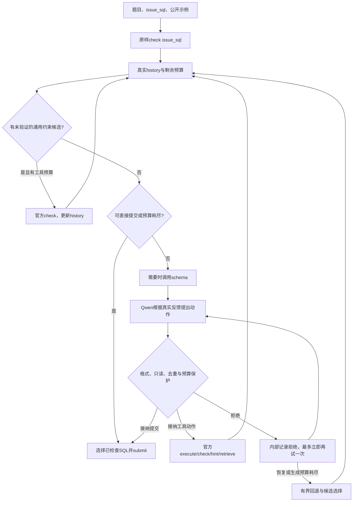

> 初次候选留档：本方案测试180/240，低于第三轮182/240，默认已回退。后续既有约束对照与最终部署见[第四轮后续报告](../v4b/v4b_report.md)。

# 第四轮：反馈训练、结构诊断与通用约束修正

完整CPU测试 **180/240（75.00%）**，第三轮 **182/240（75.83%）**，变化 **-2题、-0.83个百分点**。

按CPU验证集锁定 `e34_feedback_variant`；默认配置已升级。新测试成绩没有参与选型。参见 [事先方案](v4_plan_cn.md)、[不可覆盖的选择记录](v4_selection.json)。

## 先诊断失分来源

用第三轮策略在480道train采集真实动作：最终通过 437题；已检查候选中存在三实例正确SQL的有 438题。因此选择损失只有 1题，另有 42题没有生成正确的已检查候选，主要投入放在生成与反馈修复。采集使用GPU开发推理，CPU正式结果另列。

## 本轮改动

1. `feedback_v4`：在第三轮协议保护和有限恢复上增加SQL AST、聚合/连接/过滤/投影摘要，以及schema绑定诊断。绑定检查对SQLite双引号文本值保留歧义提示；全部诊断均是辅助证据，不是语义正确性标签。
2. 训练课程：当前策略真实调用与拒绝状态，加上train gold派生的边界、去重、过滤、投影和排序扰动，全部使用真实工具反馈。候选数量动态确定，通过原样官方train scorer重放并检查三个实例。
3. 新目标先输出短reason_code再输出SQL/候选ID，诊断标签取自train gold AST差异和真实错误。部分上下文随机排列schema/候选摘要，ID绑定与官方观察、轨迹不变。
4. `semantic_v4`独立对照：根据公开示例列名对齐投影，并处理题目显式distinct/unique要求；最多两次额外check，计入原8次工具预算。不是任务ID答案映射，也不读取评分参考。
5. `contract_v4`保留第三轮模型提示词，仅启用投影/显式去重修正，隔离诊断提示的影响；`constraint_v4`进一步比较题意明确的数值边界和COUNT(column)去重。规则只生成通用候选，仍需真实check，最多三次规则检查共享原工具预算。
6. 追加SQL合成课程：每个train题的辅助plan+SQL生成任务，加上真实失败状态修复与旧样本保留。辅助任务不是伪造的工具轨迹；plan只是提议，不能证明SQL正确。`plan_v4`/`plan_constraint_v4`比较在同一JSON中先写短plan再写SQL，进入官方动作前去掉plan。
7. 继续复用单个未合并Qwen与LoRA，所有诊断、修复和选择的模型生成计入同一上限。

训练数据 **5871条，480个train任务，零validation/test训练样本**；最长目标 136token。数据SHA-256：`fd25307336e54fc1a9ff359994a2e70fd492466d334993ad173b83cce5940fce`。480道gold均通过三个train实例。原始采集、扰动与探查均为真实执行；这是专家增强的监督动作训练，不是强化学习。来源见 [数据核验](v4_data_audit.json)。

追加课程 **2740条、480个train题**，最长目标270token，推理生成上限512；其中480条是根据训练gold AST构造的辅助SQL合成任务，其他修复状态来自真实反馈。数据与初始5871条课程分别核验，均无validation/test标签。见[追加课程审计](v4_synthesis_data_audit.json)。

## 训练记录

| 训练版本 | 轮数 | 使用样本 | 优化步 | 秒 | 最后轮loss |
|---|---:|---:|---:|---:|---:|
| feedback_v4 | 2 | 5871 | 734 | 3689.44 | 0.0439 |
| feedback_v4_extra | 1 | 2740 | 172 | 834.46 | 0.2060 |

两套课程均从第二轮onpolicy_v001/epoch_02独立初始化；feedback_v4训练两轮，feedback_v4_extra训练一轮，合计三个新检查点，不是连续追加第三轮。只训练LoRA A/B，使用目标token交叉熵，问题、schema、工具反馈和padding均不计loss。不同课程的loss不能直接横向比较，loss下降也不能替代验证集与测试集成绩。所有检查点与训练日志分版本保留。

## 正式CPU对照

| 实验 | 划分 | 正确 | 准确率 | 模型调用 | 预测秒 |
|---|---|---:|---:|---:|---:|
| [e20_recovery4/r001](../../runs/e20_recovery4/validation/r001/score.json) | validation | 89/120 | 74.17% | 293 | 1869.56 |
| [e22_recovery_selected/r001](../../runs/e22_recovery_selected/test/r001/score.json) | test | 182/240 | 75.83% | 610 | 2655.31 |
| [e31_feedback_old_weights/r002](../../runs/e31_feedback_old_weights/validation/r002/score.json) | validation | 83/120 | 69.17% | 281 | 1702.42 |
| [e33_feedback_new_weights/r001](../../runs/e33_feedback_new_weights/validation/r001/score.json) | validation | 89/120 | 74.17% | 265 | 1859.59 |
| [e34_feedback_variant/r001](../../runs/e34_feedback_variant/validation/r001/score.json) | validation | 95/120 | 79.17% | 254 | 1765.64 |
| [e36_semantic_old_weights/r001](../../runs/e36_semantic_old_weights/validation/r001/score.json) | validation | 87/120 | 72.50% | 269 | 3190.34 |
| [e37_contract_old_weights/r001](../../runs/e37_contract_old_weights/validation/r001/score.json) | validation | 92/120 | 76.67% | 278 | 1488.66 |
| [e38_recovery_epoch1/r001](../../runs/e38_recovery_epoch1/validation/r001/score.json) | validation | 86/120 | 71.67% | 253 | 1432.88 |
| [e39_constraint_old_weights/r001](../../runs/e39_constraint_old_weights/validation/r001/score.json) | validation | 92/120 | 76.67% | 278 | 1840.63 |
| [e35_feedback_selected/r001](../../runs/e35_feedback_selected/test/r001/score.json) | test | 180/240 | 75.00% | 552 | 3172.87 |

核心对照结论：
- 仅丰富诊断：83/120，相对89题为-6题。
- 仅替换新权重：86/120，相对89题为-3题。
- 诊断与新权重组合：89/120，相对89题为+0题。
- 保留旧提示并增加基础约束：92/120，相对89题为+3题。
- 增加显式数值/去重计数约束：92/120，相对89题为+3题。

这些结果用于区分提示、权重和规则的收益，不能将组合的全部提升归因于LoRA。GPU预算增至6次、优先新候选等未进入正式选型的对照也完整列出。

四个核心条件为第三轮旧控制器/旧权重、e31新诊断控制器/旧权重、e38_recovery_epoch1旧控制器/新权重、e33新诊断控制器/新权重。e36为丰富诊断+基础约束/旧权重，e37为旧提示+基础约束/旧权重，e39为旧提示+扩展约束/旧权重；e34及可选e40/e41是GPU筛选后的完整CPU确认。旧控制器实现保留原样，入口仅增加新分支。

日志身份说明：decisions.jsonl的controller字段沿用recovery_v3基类标签，实际策略以run_metadata.json中的config.controller和对应源码哈希为准；模型身份则来自每次generation的adapter SHA。

每个CPU预测进程固定四核、workers=1。e36使用CPU8–11，其余核心对照使用P核组；独立实验和GPU训练存在并发，耗时只作本机测量，不据此宣称严格速度提升。e31/r001因SQLite双引号误导性警告而中止，不计正式成绩。

## GPU开发筛选

GPU筛选只用于缩小验证候选，不作为正式CPU成本或教师复现成绩。同一配置已观察到GPU/CPU相差1题，因此第一阶段最高分提前CPU确认，最后再确认GPU最高分附近尚未完整CPU评测的候选。全部已启动的正式CPU验证完成后才锁定，所有开发结果保留。

| 实验 | 轮数 | 正确/120 | 模型调用 |
|---|---:|---:|---:|
| dev_v4_e1_contract | 1 | 91/120 | 245 |
| dev_v4_e1_feedback | 1 | 89/120 | 257 |
| dev_v4_e1_feedback6 | 1 | 89/120 | 288 |
| dev_v4_e1_prefer_model | 1 | 89/120 | 257 |
| dev_v4_e1_recovery | 1 | 87/120 | 253 |
| dev_v4_e1_recovery6 | 1 | 89/120 | 305 |
| dev_v4_e1_semantic | 1 | 95/120 | 246 |
| dev_v4_e2_contract | 2 | 91/120 | 256 |
| dev_v4_e2_feedback | 2 | 87/120 | 271 |
| dev_v4_e2_recovery | 2 | 89/120 | 265 |
| dev_v4_e2_semantic | 2 | 89/120 | 261 |
| dev_v4_extra_constraint | alt1 | 80/120 | 290 |
| dev_v4_extra_plan | alt1 | 86/120 | 260 |
| dev_v4_extra_plan_constraint | alt1 | 86/120 | 260 |
| dev_v4_extra_recovery | alt1 | 73/120 | 299 |

开发对照的结论：同一semantic控制器下，第一轮/第二轮检查点的GPU验证为95/120与89/120，继续训练没有改善该组合。追加SQL合成课程的四组GPU开发分数为[80, 86, 86, 73]，最高86/120，未超过第一套课程的最佳组合，因此没有以最新训练版本替换已选候选。训练/推理上下文差异和模型容量可能影响迁移，但本轮没有把原因逐项隔离，不能把退步确定归因于某一个因素。以上均为GPU筛选，正式结论以CPU验证和锁定测试为准。

## 测试变化与成本

逐题改善 8题，退步 10题，净变化 -2题。

| 指标 | 第三轮 | 本轮锁定方案 |
|---|---:|---:|
| 模型调用 | 610 | 552 |
| 输入token | 555690 | 648409 |
| 输出token | 19275 | 19902 |
| 重复提议 | 63 | 108 |
| 公开匹配仍最终错误 | 28 | 30 |
| 原稿公开匹配仍最终错误 | 8 | 12 |
| 公开匹配原稿被改写 | 20 | 11 |
| 预算未尽回退失败 | 2 | 2 |
| 平均收费工具 | 3.65 | 3.51 |
| CPU预测秒 | 2655.31 | 3172.87 |
| 评分秒 | 4.50 | 4.52 |
| CPU秒 | 10563.34 | 12609.16 |
| 峰值RSS MiB | 4990.26 | 4991.02 |

本轮实测每题最多 4次生成、单次最多 138新token、最多 8次收费工具。模型自主接受动作：`{"check": 189, "submit": 172, "repair_hint": 79}`。静态修正与回退不计入模型自主动作。

全部官方工具/提交次数：`{"check": 503, "schema": 229, "submit": 240, "repair_hint": 111}`；静态约束决策：`{"static_projection_contract": 10, "static_contract_selection": 2, "static_explicit_distinct": 2}`。这是混合控制器，自动原稿检查/schema/规则与Qwen自主提议分别统计；不能把全部工具动作都归因于模型。

能力边界：本轮训练包含execute/retrieve课程，但所选测试策略没有自主使用`execute`、`retrieve`。因此本次成绩不能证明已经学会主动值探查或检索规划；工具允许调用与模型实际学会调用是两回事。

**改善案例 test-fa097b64a47cd1c2**：What is the number of employees from each city?

第三轮：
```sql
SELECT City, COUNT(*) AS Employee_count
FROM employee
JOIN hiring ON employee.Employee_ID = hiring.Employee_ID
GROUP BY City;
```
本轮：
```sql
SELECT COUNT(*) AS Employee_count, City FROM employee GROUP BY City
```

**改善案例 test-a9601bc8da0bfa57**：Show names of all high school students who do not have any friends.

第三轮：
```sql
SELECT H.name FROM Highschooler AS H WHERE NOT H.ID IN (SELECT F.student_id FROM Friend AS F)
```
本轮：
```sql
SELECT name FROM Highschooler EXCEPT SELECT T1.name FROM Highschooler AS T1 JOIN Friend AS T2 ON T1.id = T2.student_id
```

**退步案例 test-750c21e4ae9b7ad1**：What are the package options of all tv channels that are not playing any cartoons directed by Ben Jones?

第三轮：
```sql
SELECT Package_Option FROM TV_Channel WHERE NOT id IN (SELECT DISTINCT Cartoon.Channel FROM Cartoon WHERE Cartoon.Directed_by = "Ben Jones")
```
本轮：
```sql
SELECT DISTINCT Package_Option FROM TV_Channel WHERE NOT id IN (SELECT DISTINCT Channel FROM Cartoon WHERE Directed_by = "Ben Jones")
```

**退步案例 test-43689cbe73aa8738**：What are the names of the people who teach math courses?

第三轮：
```sql
SELECT DISTINCT teacher.Name FROM teacher JOIN course_arrange ON teacher.Teacher_ID = course_arrange.Teacher_ID JOIN course ON course_arrange.Course_ID = course.Course_ID WHERE course.Course = 'Math'
```
本轮：
```sql
SELECT teacher.Name
FROM teacher
JOIN course ON teacher.Teacher_ID = course.Course_ID
JOIN course_arrange ON course.Course_ID = course_arrange.Course_ID
WHERE course.Course = 'Math';
```

## 实际推理流程

所选控制器为`semantic_v4`，加载单一adapter。模型直接生成SQL及下一步动作，Python按协议接纳动作；通用规则候选与模型候选都通过同一官方工具验证。



schema提供结构；check只比较公开实例；execute提供真实查询结果；repair_hint提供不保证正确的缓存建议；retrieve只返回官方训练记忆。允许某动作不代表本次已学会使用，实际自主动作次数以上表为准。规则检查、模型查询都计入8次收费工具，拒绝提议也计入模型生成次数。

低风险原稿仍可能在公开匹配后直接提交；其余情况下也没有办法在推理时读取另外两个评分实例。内部reason_code、plan或静态绑定成功均不能代替验证。
## 合规与局限

官方框架、预测器、评分器、数据、观察与工具轨迹保持原样，数据库仅通过官方工具访问。离线推理只加载一个Qwen/Qwen3-0.6B@c1899de289a04d12100db370d81485cdf75e47ca与一个未合并LoRA，共606,142,464参数。所有规划生成计数，最多6次、每次不超过2048新token。正式预测四线程、16GiB RSS、两小时，评分180秒。

选中adapter：`artifacts/adapters/feedback_v4/epoch_01`，SHA-256 `3deda01e89b10e00524bfce83ae27aaeb415a4291f4f0b5691d1b5e65f780b81`。本轮训练仅A/B矩阵，基座、tokenizer、embedding与lm_head均未更新。导出只含所选adapter的两个文件，基座不导出。

问题、schema文本、提示和检索内容均为不可信数据。固定system规则、只读SQL、协议保护、去重与预算检查继续生效；没有独立对抗注入评测，不宣称注入防御已验证。静态诊断、规则和模型自评均不能证明任意数据库上的语义正确，公开匹配假阳性仍按完整评分统计。

训练只来自train，validation用于开发筛选和选型，test只在锁定后运行并用于报告分析。单种子与公开固定划分不构成普遍泛化或统计显著性结论。Codex辅助实现、数据课程、训练、分析与报告；正式推理不联系外部模型或服务，NOTICE归属保留。

启发来源：[CHESS](https://arxiv.org/abs/2405.16755)的生成/评审分工、[CHASE-SQL](https://arxiv.org/abs/2410.01943)的候选生成与选择、[ReEx-SQL](https://arxiv.org/abs/2505.12768)的执行反馈训练、[STaR](https://arxiv.org/abs/2203.14465)的验证后迭代训练。这里是受预算限制的适配，不是论文全套系统复现。

[追加权重核验](v4_synthesis_verification.json) · [完整结果](v4_results.md) · [复现说明](../../submission/REPRODUCE_V4.md) · [运行审计](v4_runtime_audit.json) · [产物核验](v4_artifact_verification.json)。所有原始日志本地保留，后续清单提供无损压缩副本。仍共用一个.venv，未创建peer_reviews或dist，未上传；本机成绩未经过教师核验。
